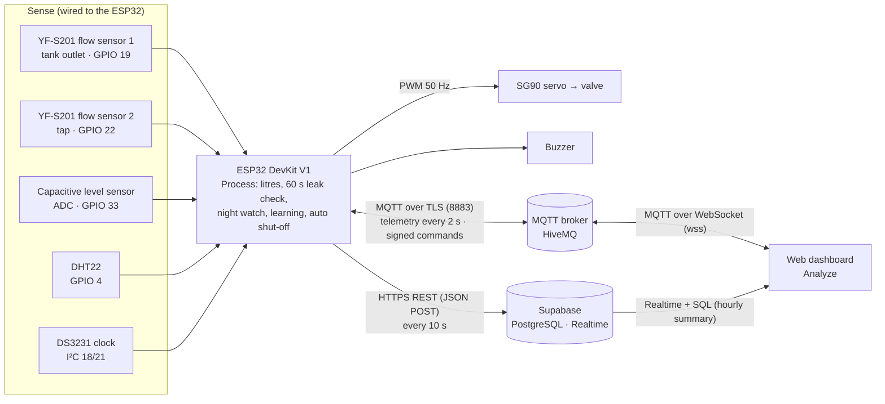

# FlowState · Team 10

**IoT Water Leak Detection and Consumption Analytics Using Dual Flow Sensors**
IoT Mini Project (UE23CS342AA3) · Sense → Ingest → Process → Store → Analyze

Live dashboard: [sustainflow.netlify.app](https://sustainflow.netlify.app/) ·
Preview without hardware: [sustainflow.netlify.app/?sample](https://sustainflow.netlify.app/?sample) (clearly labelled sample data)

FlowState puts two flow sensors on the same pipe: one where water leaves the tank, one at the tap.
Water that leaves the tank but never reaches the tap is a leak. An ESP32 measures both every second,
decides on the spot whether water is going missing, closes a valve on a critical leak, and sends the
readings to the cloud. A web dashboard turns the stored readings into answers: how much water is lost,
when it is used, whether today is unusual, whether water flows at night, and what it costs.

---

## 1. The problem

| Fact | Source |
| --- | --- |
| The leaks in an average home waste more than 9,300 US gallons (about 35,000 L) a year | [US EPA WaterSense, Fix a Leak Week](https://www.epa.gov/watersense/fix-leak-week) |
| One tap dripping once a second wastes over 11,000 L (3,000 gallons) a year | [US EPA WaterSense](https://www.epa.gov/watersense/fix-leak-week) |
| NITI Aayog warned that India faces the worst water crisis in its history, likely to get worse | NITI Aayog, *Composite Water Management Index* (2018), reported by [The Wire](https://thewire.in/environment/water-crisis-india-niti-aayog) |

Hidden leaks are silent. A cracked joint, a dripping tap or a running cistern rarely shows on a monthly
bill until a lot of water is gone. Two flow sensors on the same pipe find the difference within a minute.

**Questions FlowState answers** (the course asks for analysis first):

1. Am I losing water, and how much?
2. When do I use the most water?
3. Is today's use unusual?
4. Is water flowing at night?
5. What does it cost?

## 2. Architecture and design



| Stage | Where | What happens |
| --- | --- | --- |
| **Sense** | [`sense.ino`](ESP32_Code/FlowState_ESP32/sense.ino) | Interrupts count flow pulses (~450 per litre); the ADC reads the tank level; the DHT22 reads humidity and temperature |
| **Ingest** | [`mqtt.ino`](ESP32_Code/FlowState_ESP32/mqtt.ino), [`cloud.ino`](ESP32_Code/FlowState_ESP32/cloud.ino) | Live MQTT telemetry every 2 s; an HTTPS upload of every reading every 10 s |
| **Process** | [`process.ino`](ESP32_Code/FlowState_ESP32/process.ino), [`flowstate_rules.h`](ESP32_Code/FlowState_ESP32/flowstate_rules.h) | On the ESP32: pulses → litres, a 60 s comparison of the two sensors, Normal / Warning / Critical, night watch, hourly learning, automatic valve closing |
| **Store** | [`supabase/flowstate_setup.sql`](supabase/flowstate_setup.sql) | PostgreSQL tables with value checks, a flood limit, live inserts and an hourly analysis function |
| **Analyze** | [`Web_Dashboard/`](Web_Dashboard/) | The five questions, live view, alerts, performance metrics, valve control |

Design choices:

- **Edge processing.** Leak decisions happen on the ESP32, so a critical leak closes the valve even when Wi-Fi is down.
- **Two protocols, two jobs.** MQTT carries the live view, device status and commands (small messages, one open connection, push both ways). HTTPS REST stores every reading for analysis (simple, reliable, works through campus firewalls). If MQTT is blocked, HTTPS still works and the dashboard falls back to the database's own live updates.
- **Analysis in the database.** `get_hourly_summary()` turns ~8,600 readings a day into 24 rows, so the dashboard loads a week of analysis in one small request.

## 3. Hardware

| Part | Job | ESP32 pin | Approx. cost (₹) |
| --- | --- | --- | --- |
| ESP32 DevKit V1 | Controller with Wi-Fi | – | 400–500 |
| 2 × YF-S201 flow sensor (½") | Flow at the tank outlet and at the tap | GPIO 19, GPIO 22 | 450–550 |
| Capacitive water-level sensor | Water in the tank | GPIO 33 (ADC) | 150–350 |
| DHT22 (or DHT11, cheaper) | Humidity and temperature near the pipes | GPIO 4 | 80–250 |
| DS3231 RTC module (optional: NTP can replace it) | Keeps time without Wi-Fi | SDA 18, SCL 21 | 120–180 |
| SG90 servo + ball valve | Shut-off valve | GPIO 26 (PWM) | 300–500 |
| Active buzzer | Alarm | GPIO 13 | 20–40 |
| 5 V supply for the servo, resistors, breadboard, wires, pipe fittings | – | – | 500–800 |
| **Total** | | | **≈ ₹2,500–3,500** |

Prices are rough Indian retail ranges and vary by shop.

- The flow sensors give 5 V pulses; ESP32 pins take 3.3 V. Each signal goes through a resistor divider (10 kΩ to the pin, 20 kΩ from the pin to GND) or a logic-level converter.
- The servo gets its own 5 V supply; all grounds are joined.
- Step-by-step wiring with board and breadboard diagrams: [`docs/wiring-guide.html`](docs/wiring-guide.html).

## 4. Software

**Firmware** ([`ESP32_Code/FlowState_ESP32/`](ESP32_Code/FlowState_ESP32/), Arduino, ESP32 core 3.x), one tab per pipeline stage:

| File | Role |
| --- | --- |
| `FlowState_ESP32.ino` | Settings, shared state, `setup()` and `loop()` |
| `sense.ino` | Flow-sensor interrupts, level sensor, DHT22 |
| `process.ino` | Leak check, night watch, usage learning, valve and buzzer |
| `cloud.ino` | Wi-Fi, clock (DS3231 + NTP), HTTPS uploads to Supabase |
| `mqtt.ino` | MQTT telemetry, Last Will, alerts, ping/pong, signed valve commands |
| `console.ino` | Serial Monitor commands (`HELP`, `STATUS`, `VALVE_OPEN`, `VALVE_CLOSE`, `KEY_CHECK`, …) |
| `flowstate_rules.h` | The decision rules as plain functions, also tested on a PC |
| `secrets.example.h` | Copy to `secrets.h` (git-ignored) and fill in Wi-Fi, Supabase and the valve key |

Libraries: ArduinoJson 6.x, RTClib, ESP32Servo, DHT sensor library, Adafruit Unified Sensor, PubSubClient.
Set `ENABLE_MQTT` to `0` to build the HTTPS-only version.

**Database** ([`supabase/flowstate_setup.sql`](supabase/flowstate_setup.sql)): tables `water_readings` and `alerts`; the
public key may read and add rows but never change or delete them; values are range-checked; readings with a wrong
device clock are stored at arrival time; at most 60 readings and 30 alerts a minute are accepted.

**Dashboard** ([`Web_Dashboard/`](Web_Dashboard/)): plain HTML, CSS and JavaScript (no build step), Chart.js,
supabase-js and MQTT.js from a CDN with integrity hashes, a strict Content-Security-Policy, deployed on Netlify.

## 5. IoT protocols and connectivity

| Link | Protocol |
| --- | --- |
| Flow sensors → ESP32 | Digital pulses counted by interrupts |
| Level sensor → ESP32 | Analog voltage, 12-bit ADC |
| DHT22 → ESP32 | Single-wire digital |
| DS3231 ↔ ESP32 | I²C |
| ESP32 → servo | PWM, 50 Hz |
| ESP32 ↔ router | Wi-Fi 802.11 b/g/n, 2.4 GHz |
| ESP32 ↔ broker | **MQTT 3.1.1 over TLS** (port 8883) |
| ESP32 → Supabase | **HTTPS REST**, JSON POST, connection kept alive |
| ESP32 → time servers | NTP |
| Browser ↔ broker | MQTT over secure WebSocket (port 8884) |
| Browser ↔ Supabase | HTTPS queries and Realtime over WebSocket |

MQTT topics (root `flowstate/team10-d76014`, set in the sketch and the dashboard):

| Topic | Direction | QoS / retain | Content |
| --- | --- | --- | --- |
| `…/telemetry` | ESP32 → | QoS 0 | Every 2 s: flows, loss, level, valve, status, total, humidity, Wi-Fi signal, uptime, sequence number |
| `…/status` | ESP32 → | QoS 1, retained | `online` on connect; the broker publishes the **Last Will** `offline` if the ESP32 drops off |
| `…/alert` | ESP32 → | QoS 0 | Leak, night-flow, anomaly and valve alerts, the moment they happen |
| `…/cmd` | → ESP32 | QoS 1 | Valve commands signed with HMAC-SHA256 |
| `…/ack` | ESP32 → | QoS 0 | The result of each command |
| `…/ping`, `…/pong` | both | QoS 0 | Round-trip time measurement |

Example telemetry message (about 220 bytes):

```json
{"seq":41,"ts":1762930000,"f1":4.27,"f2":3.98,"loss":6.8,"lvl":63.5,"valve":1,"auto":1,"leak":"Warning",
 "anom":"Learning","night":"Normal","total":12.346,"hum":58.2,"temp":27.1,"rssi":-61,"up":3600,"heap":182000,"upms":240,"hfail":0}
```

Connectivity efficiency, as built:

- MQTT keeps **one** TLS connection open: a 220-byte message every 2 s (about 6.6 KB a minute) with no handshake per message.
- HTTPS keeps its TLS connection open between uploads, so most uploads skip the handshake; a dropped connection is retried once.
- Sequence numbers let the dashboard count lost MQTT messages; the ESP32 reports its own HTTPS upload time and failures.
- MQTT reconnects back off from 5 s up to 2 minutes, so a blocked port cannot keep stalling the sensor loop.

Measured: see [section 9](#9-testing-and-results).

## 6. Data analytics and visualization

The dashboard ([sustainflow.netlify.app](https://sustainflow.netlify.app/)) has:

- **The IoT pipeline**: the five stages light up as each reading arrives, each with its live value.
- **Live from the ESP32**: both flows and the gap between them, a 15-minute flow chart, the leak scale, tank level, valve, today's litres and cost, humidity and temperature.
- **What the data tells us**: the five questions, each with a plain answer and a chart:
  water lost per day (reached the tap vs lost), litres by hour (average day vs today), today against a normal day by the same time,
  seven nights of 2–5 AM flow, and cost at an editable tariff.
- **Connectivity and performance**: MQTT round trip, delivery, traffic, readings stored over HTTPS, upload time, Wi-Fi signal, uptime, a 24-hour reliability chart and an MQTT vs HTTPS comparison.
- **Alerts** with filters, **CSV/JSON download** of the raw readings, an **architecture diagram**, and **valve control**.

## 7. What is new in this project

- **Differential flow measurement** with two sensors instead of watching one meter, so a leak shows within one 60-second window.
- **Decisions on the edge**: classification, night watch and automatic shut-off run on the ESP32 without the cloud.
- **Two protocols with a reason each**, with live, measured efficiency numbers on the dashboard.
- **Authenticated actuation over an untrusted broker**: valve commands are signed (HMAC-SHA256), time-limited and never reusable; the key never leaves the browser.
- **Self-checking data**: the database refuses impossible values and corrects a wrong device clock; the dashboard ignores future-dated readings.
- **Learned normal use**: the ESP32 learns each hour over 3 days; the dashboard compares today with the previous days.

## 8. Setup

1. **Database**: create a Supabase project, open the SQL Editor, paste and run [`supabase/flowstate_setup.sql`](supabase/flowstate_setup.sql) once. Copy the project URL and the **anon** key from *Project Settings → API Keys*.
2. **Firmware**: install the libraries above (Arduino IDE, board *ESP32 Dev Module*). Copy `secrets.example.h` to `secrets.h`, fill in Wi-Fi (2.4 GHz), the Supabase URL and anon key, and a random valve key. Upload, open the Serial Monitor at 115200 baud, type `STATUS`.
3. **Dashboard**: on Netlify, connect this repository (base directory `Web_Dashboard`, build command from [`netlify.toml`](netlify.toml)) and set the environment variables `SUPABASE_URL` and `SUPABASE_ANON_KEY`. Optional: `MQTT_URL`, `MQTT_TOPIC_ROOT`. Step by step: [`docs/DEPLOY.md`](docs/DEPLOY.md).
4. **Check**: the dashboard should show *Live*; type the valve key in the valve panel and compare its *Key check* with `KEY_CHECK` on the Serial Monitor.

Never put the `service_role` key, the database password or `secrets.h` anywhere public.

## 9. Testing and results

Details, procedures and the hardware test sheets: [`docs/TESTING.md`](docs/TESTING.md).

| Suite | Command | Result |
| --- | --- | --- |
| Dashboard unit tests (analysis, signing, telemetry parsing) | `npm test` | 26 passing |
| Browser tests (production CSP, simulated Supabase and MQTT broker) | `npm run test:e2e` | 12 passing |
| Database (setup applied twice, permissions, limits, hourly analysis) | `npm run test:db` | 42 checks passing (also on the live project, rolled back) |
| Firmware rules on a PC (leak levels, night window, learning, command checks) | `g++` (see `tests/firmware`) | 61 checks passing |
| Firmware build for the ESP32 (with and without MQTT) | CI | 85 % / 83 % of flash, 16 % of RAM |

Measured on the real HiveMQ broker with a stand-in device: MQTT round trip ≈ 310 ms (median), 100 % delivery,
220 bytes per message, a signed valve command confirmed in 1.2 s.

## 10. Team

| Member | Role | Part of the pipeline |
| --- | --- | --- |
| *Name* | Team Lead | |
| *Name* | Second Lead | |
| *Name* | Member | |
| *Name* | Member | |

The firmware tabs map onto the pipeline stages so each member can own and present one part (see [section 2](#2-architecture-and-design)).

## Repository layout

```text
ESP32_Code/FlowState_ESP32/   firmware (Arduino)
supabase/flowstate_setup.sql  database setup
Web_Dashboard/                dashboard (Netlify)
scripts/netlify-build.mjs     writes env.js and the security headers at deploy time
tests/                        dashboard, browser, database and firmware tests
docs/                         wiring guide, testing, report material
archive/                      an earlier design, not used by the final system
```

## License

MIT, see [LICENSE](LICENSE).
